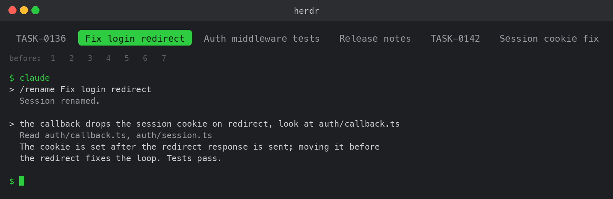

# herdr-tab-label

A Claude Code hook that keeps the [Herdr](https://herdr.dev) tab label equal to the session name.

A Herdr tab strip that reads `2`, `3`, `18` makes it easy to hand work to the wrong pane. With this hook each tab reads what the session is about, for example `TASK-0136` or `Fix login redirect`, and the label follows when the work changes.

- Name the session with `/rename` (bare `/rename` with [better-rename](../better-rename) suggests names). Claude Code writes the name to the terminal title; Herdr already shows that title.
- At the end of every turn the hook copies that title onto the tab label. No guessing from branches or task files: the session's own name is the only source.
- A new session in the same tab (`claude` started again, or `/clear`) drops the label the previous session left, so the tab goes back to its number until the new session is named. Labels you set by hand are never touched; `--resume` keeps the name.
- Outside Herdr, or on any error, it does nothing and exits quietly.



## Install

```
/plugin install herdr-tab-label --marketplace trkaplan/claude-plugins
```

Answer `y` to add the marketplace and pick a scope (user scope = every session). Requires Node 18 or newer and the `herdr` CLI on `PATH`; tested with Herdr integration version 7.

## How the label is made

| Terminal title | Tab label | Why |
| --- | --- | --- |
| `TASK-0136 Fix login redirect bug` | `TASK-0136` | A task id (`ABC-123` shape) is the shortest recognizable identity |
| `Fix login redirect bug` | `Fix login redirect bug` | Up to 22 characters are kept as they are |
| `Session cookie and redirect fixes` | `Session cookie and` | Longer titles are cut at a word boundary |
| `my-repo` (the folder name) | unchanged | The session was never renamed; the current label is left alone |

## Hooks this plugin adds

Two command hooks (`hooks/hooks.json`), both with a 10 second timeout:

| Hook | What it does |
| --- | --- |
| `Stop` | Runs `node hooks/herdrTabLabel.mjs` at the end of every turn: writes the label and remembers it |
| `SessionStart` | Runs `node hooks/herdrTabLabel.mjs start`: when the source is `startup` or `clear` and the tab still carries the label this plugin wrote, clears it. `resume` and `compact` change nothing |

### What it reads

- Environment variables Herdr sets for the pane: `HERDR_ENV`, `HERDR_PANE_ID`, `HERDR_TAB_ID`, `HERDR_WORKSPACE_ID`. If the first three are missing it exits at once.
- The current working directory's folder name, to recognize an unnamed session.
- The hook input on `SessionStart` (its `source` field only).
- Its own note of the last label it wrote, one small text file per tab under `~/.cache/herdr-tab-label/`. That is the only thing it writes to disk.
- The output of `herdr agent list` (its own pane's terminal title) and `herdr tab list --workspace <id>` (the current label, so an unchanged label is not written again).

It reads no session content and no settings, and makes no network or model calls.

### Commands it runs

- `herdr agent list`
- `herdr tab list --workspace <id>`
- `herdr tab rename <tab id> <label>`, only when the label differs from the current one.
- `herdr tab rename <tab id> ""` on a fresh session, only when the tab still carries a label this plugin wrote.

Nothing else. Every error is swallowed so the session is never affected.

## Use it without installing: a prompt for your agent

If you would rather have the hook as a script inside your own repository, give this to your coding agent and adapt the paths:

```
Write a Claude Code Stop hook that keeps the Herdr tab label equal to the
session name at the end of every turn.

Why: the Herdr tab strip shows "2", "3", "18" and I cannot tell which pane
does what. The tab label should carry the session name.

The source is the session's OWN NAME (I set it with /rename, Claude Code
writes it to the terminal title, Herdr reports it in `herdr agent list` as
terminal_title / terminal_title_stripped). Do not guess from task numbers,
branch names or files; only copy that title.

Behavior:
1. If HERDR_ENV is not "1" or HERDR_PANE_ID or HERDR_TAB_ID is missing, exit
   without doing anything.
2. Run `herdr agent list` (JSON), find the agent whose pane_id equals mine,
   read terminal_title_stripped (fallback terminal_title).
3. Make a short label from the title:
   - if it contains a task id such as TASK-0123 or PROJ-45, use only that;
   - if the title equals the repo folder name (session never renamed),
     return null and leave the current label alone;
   - otherwise at most 22 characters, cut at a word boundary, strip
     trailing punctuation and dashes.
4. Run `herdr tab list --workspace $HERDR_WORKSPACE_ID`, read the current
   label; if it already equals the new label do not write (no flicker).
5. Run `herdr tab rename $HERDR_TAB_ID <label>`.
6. Remember the label you wrote (one small file per tab id under a cache
   dir). Add a SessionStart hook: when the hook input's source is "startup"
   or "clear" and the tab still carries the remembered label, clear it with
   `herdr tab rename $HERDR_TAB_ID ""` so the tab shows its number again;
   on "resume" or "compact" do nothing. Never clear a label you did not
   write.
7. Swallow every error; without Herdr or on unexpected JSON exit quietly.
   The hook must never break the session.

Put it in scripts/herdrTabLabel.mjs (Node, ESM, no dependencies, call herdr
with execFileSync), start the file with a comment explaining WHY it works
this way, and make it runnable by hand. Register it in .claude/settings.json
as a Stop hook and a SessionStart hook with timeout 10. Export the label function and add a small
test: task id wins, repo name gives null, long title is cut.
```

The reference implementation is [`hooks/herdrTabLabel.mjs`](hooks/herdrTabLabel.mjs): copying that file is less work than the prompt.

## Support

- **Bugs and questions:** open an issue at https://github.com/trkaplan/claude-plugins/issues
- **Troubleshooting:** run `node <plugin dir>/hooks/herdrTabLabel.mjs` by hand inside a Herdr pane; if the label does not change, check `herdr agent list` shows your pane with a terminal title.

## Development

```
node --test plugins/herdr-tab-label/tests/label.test.mjs
claude plugin validate --strict plugins/herdr-tab-label
```
